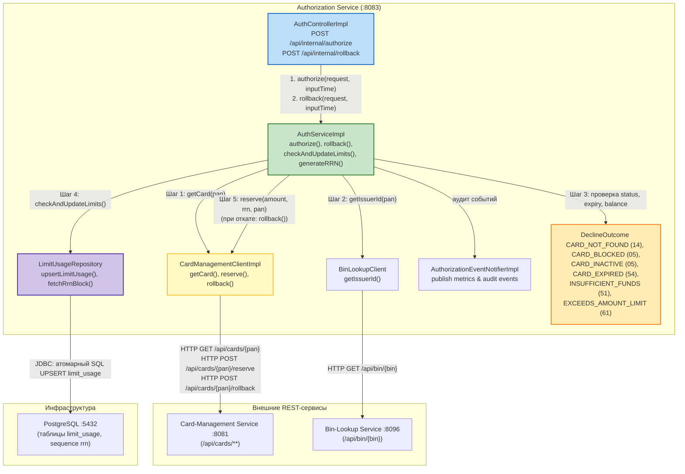
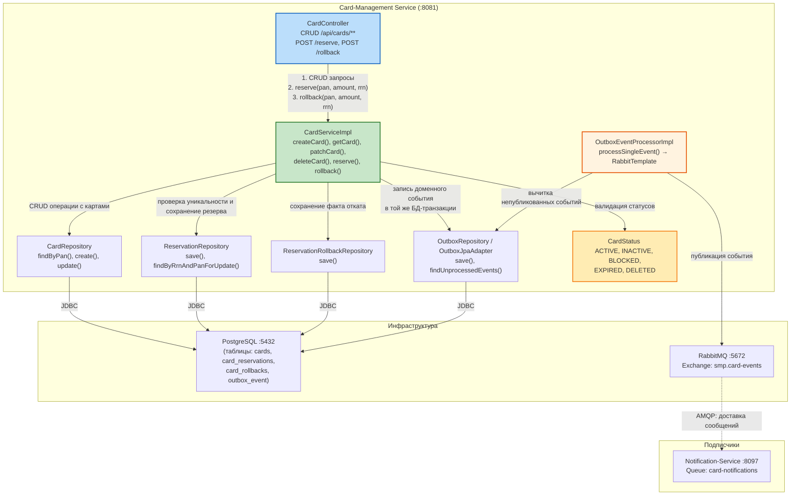

# А3. C4 Level 3 - Component (Authorization и Card-Management)

## Чего не хватало в проекте

Компонентный уровень (Level 3) в документации СМП полностью отсутст

## Что сделано

Построены подробные компонентные диаграммы C4 Level 3 для двух ключевых микросервисов ядра процессинга:
1. **Authorization Service** 
2. **Card-Management Service** 

---

## 1. Authorization Service - Диаграмма

## 2. Card-Management Service — Component Diagram

