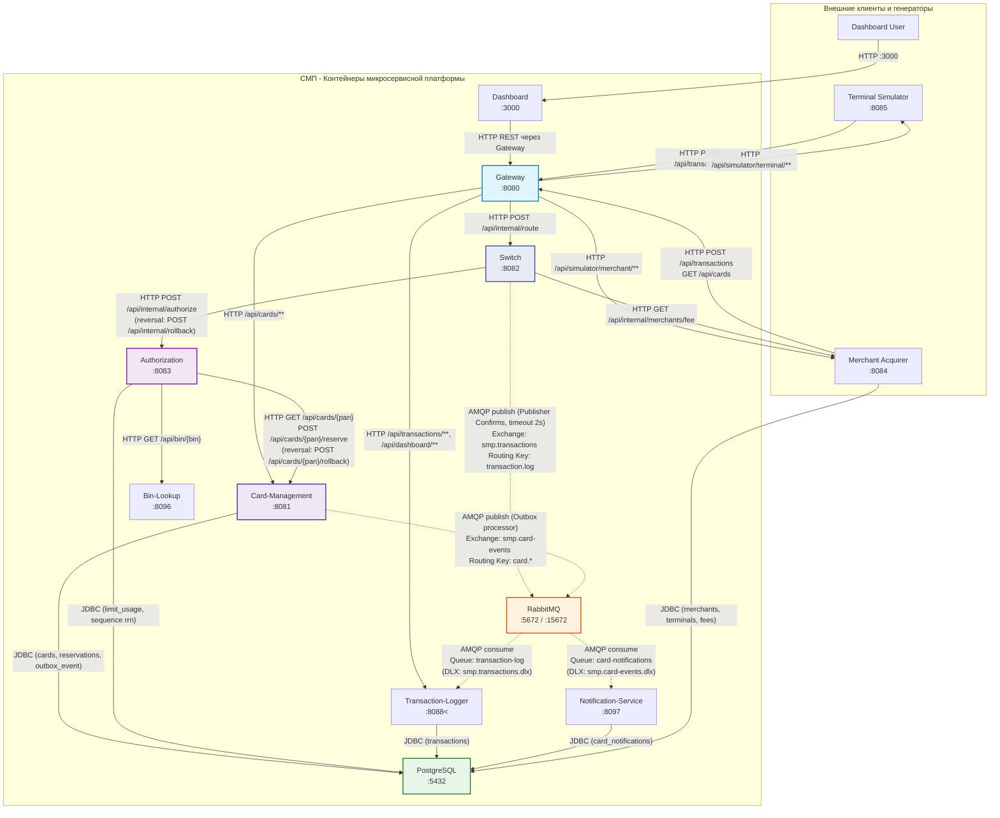

# А2. C4 Level 2 - Container Diagram

## Чего не хватало в проекте

1. **Не были разделены синхронные и асинхронные коммуникации**: вызовы HTTP/REST, транзакции JDBC и сообщения AMQP рисовались одинаковыми стрелками.
2 **Несоответствие сервисов и портов реальной конфигурации `docker-compose.yaml` и `.env.example`**:
   - Порты в устаревшей документации не соответствовали реальным контейнерам (`Card-Management`: 8081, `Switch`: 8082, `Authorization`: 8083, `Merchant-Acquirer`: 8084, `Terminal-Simulator`: 8085, `Transaction-Logger`: 8088, `Bin-Lookup`: 8096, `Notification-Service`: 8097).

## Что сделано

Построена детальная Container-диаграмма C4 Level 2, сверенная с кодом всех сервисов, `docker-compose.yaml` и конфигурациями Spring Boot:
- Сплошные стрелки = синхронные вызовы (HTTP REST, JDBC к PostgreSQL).
- Пунктирные стрелки = асинхронное взаимодействие (AMQP через RabbitMQ).

## Диаграмма

