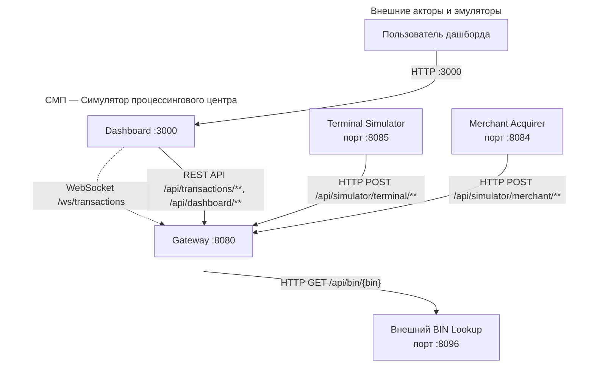

# А1. C4 Level 1 - Context Diagram

## Чего не хватало в проекте

В исходной документации (`docs/architecture.md`) границы системы "СМП vs. внешний мир" явно не проведены:
отсутствовала отдельная Context-диаграмма, не были специфицированы внешние акторы, точки сочленения и протоколы входа каждого участника.

## Что сделано

Построена Context-диаграмма C4 Level 1, которая строго отделяет ядро СМП от внешних систем/акторов и явно документирует протоколы взаимодействия.

## Диаграмма

