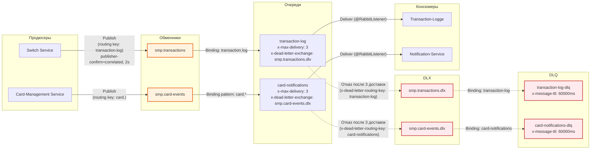

# А5. RabbitMQ-топология

## Чего не хватало в проекте

В исходной документации архитектуры описание очередей ограничивалось текстовой таблицей:
не было наглядной схемы топологии брокера с отображением типов обменников, биндингов, DLX/DLQ, параметров подтверждения доставки , политик повторной обработки и TTL сообщений

## Что сделано

Построена детальная визуальная диаграмма RabbitMQ-топологии СМП, точно отражающая Java-конфигурации классов `RabbitMQConfig` в сервисах `switch`, `card-management`, `transaction-logger` и `notification-service`.

## Диаграмма

