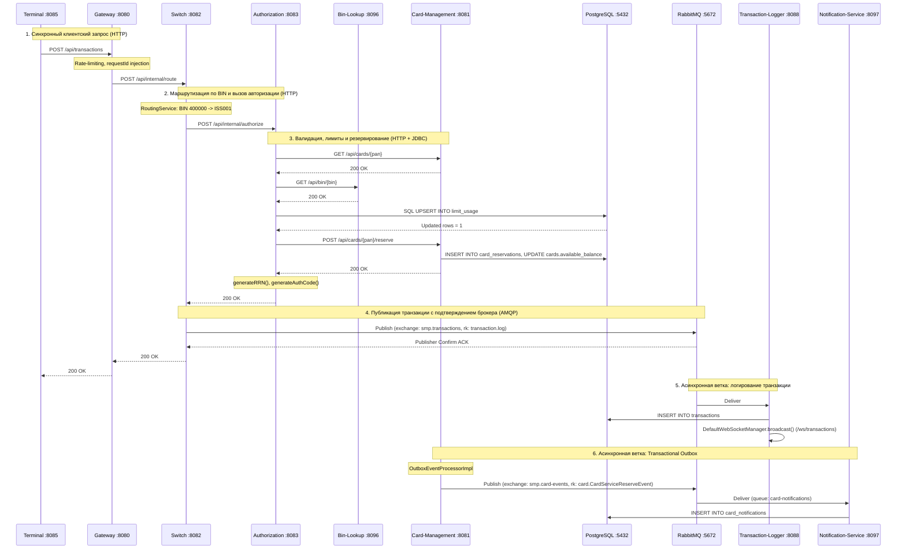
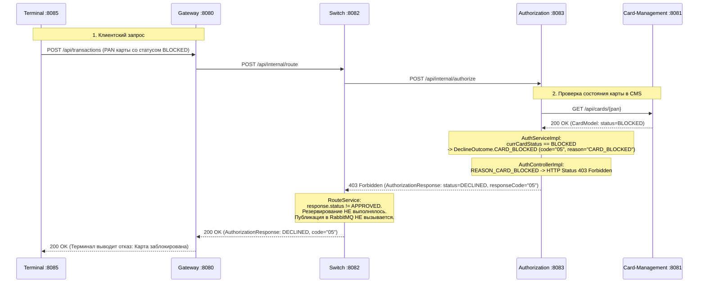
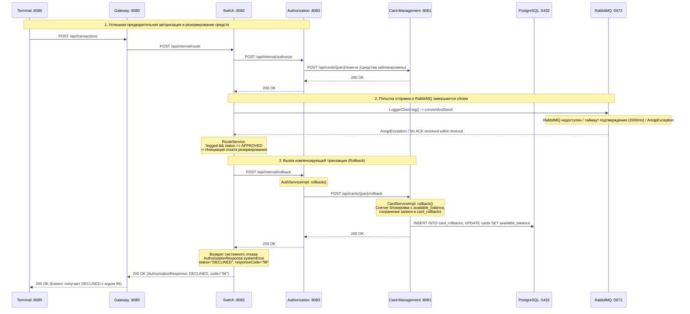

# А4. Sequence — Путь транзакции (3 сценария)

## Чего не хватало в проекте

В исходной документации (`docs/architecture.md`) присутствовала только базовая mermaid sequence диаграмма happy path. Полностью отсутствовали:
1. Сценарий отказа при блокировке карты
2. Сценарий автоматического отката резервирования при сбое публикации в RabbitMQ (Publisher Confirms timeout), хотя этот критический механизм полностью реализован в коде `RouteService.java`.
3. Разметка синхронных REST-запросов и асинхронных вилок.

## Что сделано

Построены 3 детальные sequence-диаграммы, строго соответствующие реализации в сервисах:
1. **Happy path** - успешная авторизация, бронирование средств, подтверждение брокера, асинхронный лог
2. **Declined** - отклонение по статусу `BLOCKED`, ранний выход без резервирования и без публикации в очередь
3. **Reversal** - успешная авторизация -> таймаут подтверждения брокера RabbitMQ -> откат в Authorization и CMS -> возврат клиенту кода `96`.

---

## Сценарий 1: Happy Path

## Сценарий 2: Declined

## Сценарий 3: Reversal

