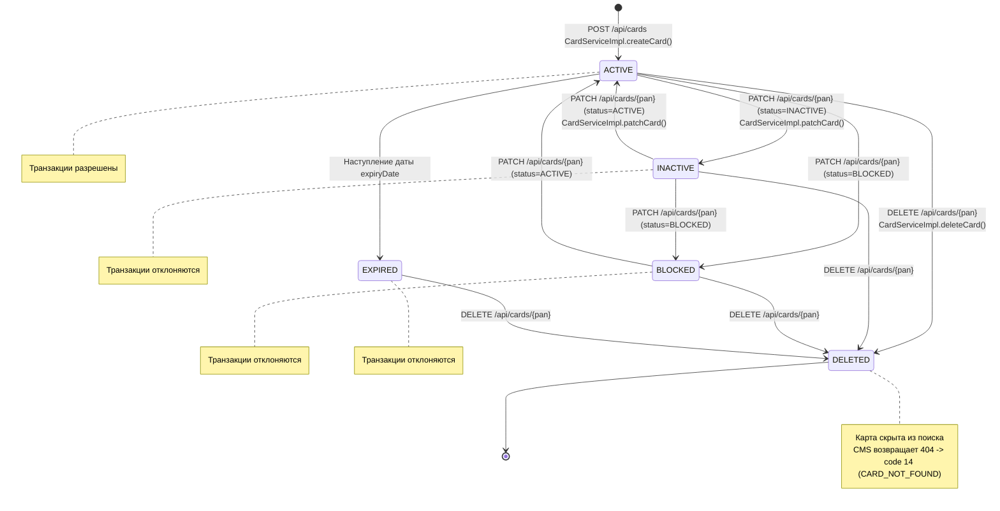
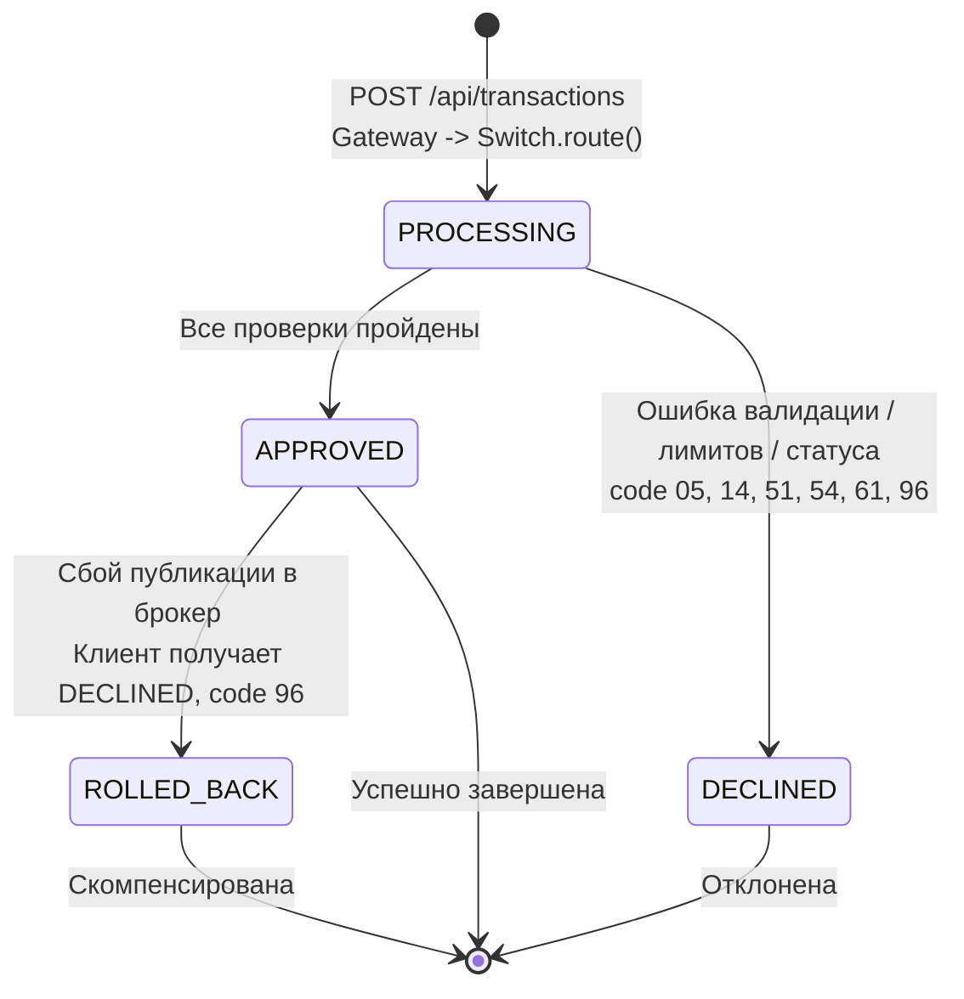

# А6. State-transition — Диаграммы состояний

## Чего не хватало в проекте

В исходной документации отсутствовали диаграммы состояний и таблицы переходов:
не были формализованы допустимые и запрещенные переходы статусов карт, не описан жизненный цикл транзакции от инициализации до терминальных состояний

## Что сделано

Построены две диаграммы переходов состояний:
1. **Жизненный цикл карты**: enum `CardStatus` (`ACTIVE`, `INACTIVE`, `BLOCKED`, `EXPIRED`, `DELETED`).
2. **Жизненный цикл транзакции**: модель `TransactionStatus` (`APPROVED`, `DECLINED`), причины отказа `DeclineOutcome` и механизм роллбэка

---

## 1. Card.status — Жизненный цикл карты

## 2. Transaction — Жизненный цикл транзакции

